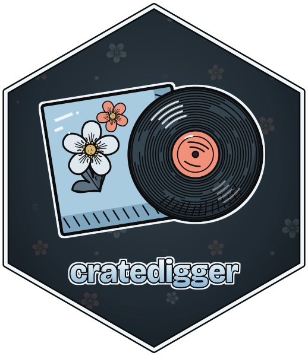
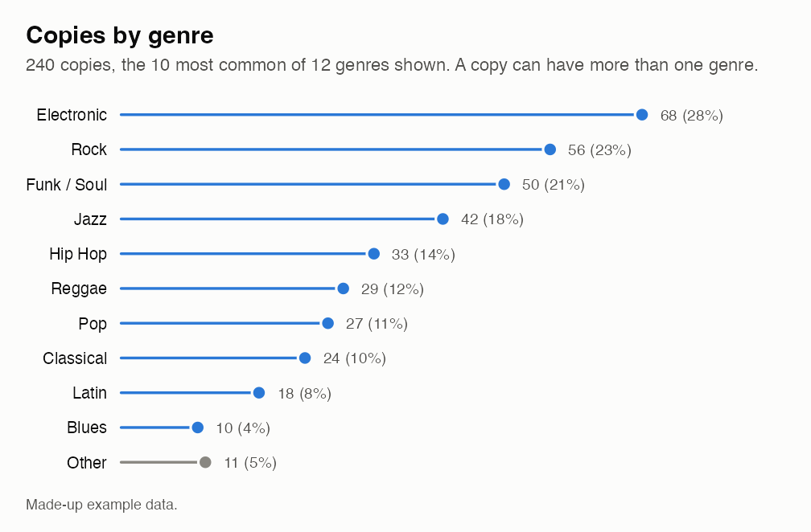

# tidycrates 

<!-- badges: start -->
[](https://github.com/mcanzi/tidycrates/actions/workflows/R-CMD-check.yaml)
<!-- badges: end -->

tidycrates reads the [Discogs](https://www.discogs.com/) database through the [Discogs API](https://www.discogs.com/developers) and returns <span class="hl">tidy tibbles</span>. Releases, master releases, artists and labels come back with one row each, and their tracklists, credits, formats and identifiers can be unnested into one row per item.

Requests stay within the <span class="hl">rate limit</span> of the API, which is 25 requests a minute without a token and 60 with one. A request that still hits the limit is retried. Long lists can be fetched in full with `all = TRUE`, and responses can be cached for the session.

## Installation

tidycrates is not on CRAN yet. Install it from GitHub:

```r
pak::pak("mcanzi/tidycrates")
```

## Token

The database can be read without a token. A <span class="hl">personal access token</span> raises the limit to 60 requests a minute. Generate one in the [developer settings](https://www.discogs.com/settings/developers) of your Discogs account and add it to `.Renviron`, so it stays out of your scripts:

```r
usethis::edit_r_environ()
```

```
DISCOGS_TOKEN=your-token
```

After restarting R, tidycrates uses the token for every request. `dig_auth()` sets a different token for the current session.

## Example

The output below comes from <span class="hl">made-up data</span>: the band Juniper Static, the label Fernhollow Records and their releases do not exist. The package tests use the same data. The real API returns other records for these IDs.

```r
library(tidycrates)

release <- dig_release(1001)
release |> dplyr::select(title, artist, year, country, label, format)
#> # A tibble: 1 × 6
#>   title           artist          year country label              format
#>   <chr>           <chr>          <int> <chr>   <chr>              <chr>
#> 1 Lantern Weather Juniper Static  1994 UK      Fernhollow Records Vinyl
```

The tracklist, credits, formats and identifiers are <span class="hl">list columns</span>. `dig_tracklist()`, `dig_credits()`, `dig_formats()` and `dig_identifiers()` turn them into one row per item, and `seconds` gives each duration in seconds:

```r
dig_tracklist(release)
#> # A tibble: 2 × 7
#>   release_id position type  title                 artist duration seconds
#>        <int> <chr>    <chr> <chr>                 <chr>  <chr>      <int>
#> 1       1001 A        track Lantern Weather       <NA>   3:32         212
#> 2       1001 B        track Lantern Weather (Dub) <NA>   3:30         210

dig_credits(release) |> dplyr::select(name, credited_as, role)
#> # A tibble: 6 × 3
#>   name               credited_as role
#>   <chr>              <chr>       <chr>
#> 1 Paperweight Design Paperweight Design
#> 2 Ida Marsh          <NA>        Engineer
#> 3 Tomas Reed         <NA>        Engineer
#> 4 Noor Halden        NH          Lacquer Cut By
#> 5 Felix Arno         Felix A.    Mixed By
#> 6 Malin Ödegaard     M. Ödegaard Producer, Written-By
```

`dig_artist_releases()` lists everything an artist appears on, with the number of users who have each item in their collection or wantlist:

```r
dig_artist_releases(3001) |>
  dplyr::select(id, type, title, year, have, want)
#> # A tibble: 3 × 6
#>      id type    title              year  have  want
#>   <int> <chr>   <chr>             <int> <int> <int>
#> 1  1004 release Moth Radio         1997    43   160
#> 2  2001 master  Small Hours Atlas  1997    70    90
#> 3  2002 master  Paper Moon Signal  1997    25    30
```

`dig_master_versions()` lists the versions of a master release, which can be filtered by format, label, year and country:

```r
dig_master_versions(2001) |>
  dplyr::select(release_id, country, released, major_formats)
#> # A tibble: 3 × 4
#>   release_id country     released major_formats
#>        <int> <chr>       <chr>    <chr>
#> 1       1001 Bulgaria    1997     Cassette
#> 2       1005 UK & France 1997     CD
#> 3       1006 Poland      1997     Cassette
```

`dig_collection()` and `dig_wantlist()` list the releases in the collection or wantlist of a user. Anyone can read a public collection, but a private one can only be read with the token of its owner. Collections and wantlists are Restricted Data, see [Terms of use](#terms-of-use).

`dig_tally()` counts a collection by genre, style, format, label, artist, year, decade or month added, without sending more requests. A copy with several genres counts once for each:

```r
collection <- dig_collection("your-username", all = TRUE)
dig_tally(collection, "genre")
#> # A tibble: 2 × 3
#>   genre          n share
#>   <chr>      <int> <dbl>
#> 1 Electronic     3 1
#> 2 Pop            2 0.667
```

`dig_plot()` draws the same counts with ggplot2. Both also work on the output of the database and list functions, for example to count the releases of a label by decade or the credits of an artist by role:

```r
dig_plot(collection, "genre")
dig_plot(dig_label_releases(4001, all = TRUE), "decade")
dig_plot(dig_artist_releases(3001, all = TRUE), "role")
```



Every plot has a title, a subtitle that says what is shown, alt text for screen readers and the caption "Data provided by Discogs.". Values are written next to their marks, and the colours have enough contrast to be read without relying on colour alone.

## Terms of use

The [API Terms of Use](https://support.discogs.com/hc/en-us/articles/360009334593-API-Terms-of-Use) apply to all data returned by tidycrates, and using it means accepting them. In the United States, they require you to be at least 18 years old.

Only some fields are available under the <span class="hl">CC0 licence</span>: titles, notes, dates, formats, tracklists, identifiers, credits, versions and links of releases, and the names, notes and releases of artists and labels. Other fields, such as genres, styles, community counts and ratings, are not listed as CC0 and can only be used under the Terms of Use.

Collections, wantlists and usernames are <span class="hl">Restricted Data</span>. Discogs grants a limited, personal licence to use them: they may not be passed on to anyone else or used commercially, and their use must respect the privacy of their owners. Only publish a collection or wantlist, or tallies and plots of it, if it is your own or its owner has agreed. Images and marketplace data, such as prices, are Restricted Data too and are left out.

If you show data from Discogs, put "Data provided by Discogs." next to it with a link to the page on Discogs, which is in the `uri` column. `dig_plot()` adds the text as a caption, and the link goes wherever you publish the plot. Data that are more than six hours older than the Discogs website may not be shown, and data may not be stored longer than needed, so cached responses are never kept longer than six hours.

This application uses Discogs' API but is not affiliated with, sponsored or endorsed by Discogs. 'Discogs' is a trademark of Zink Media, LLC.
